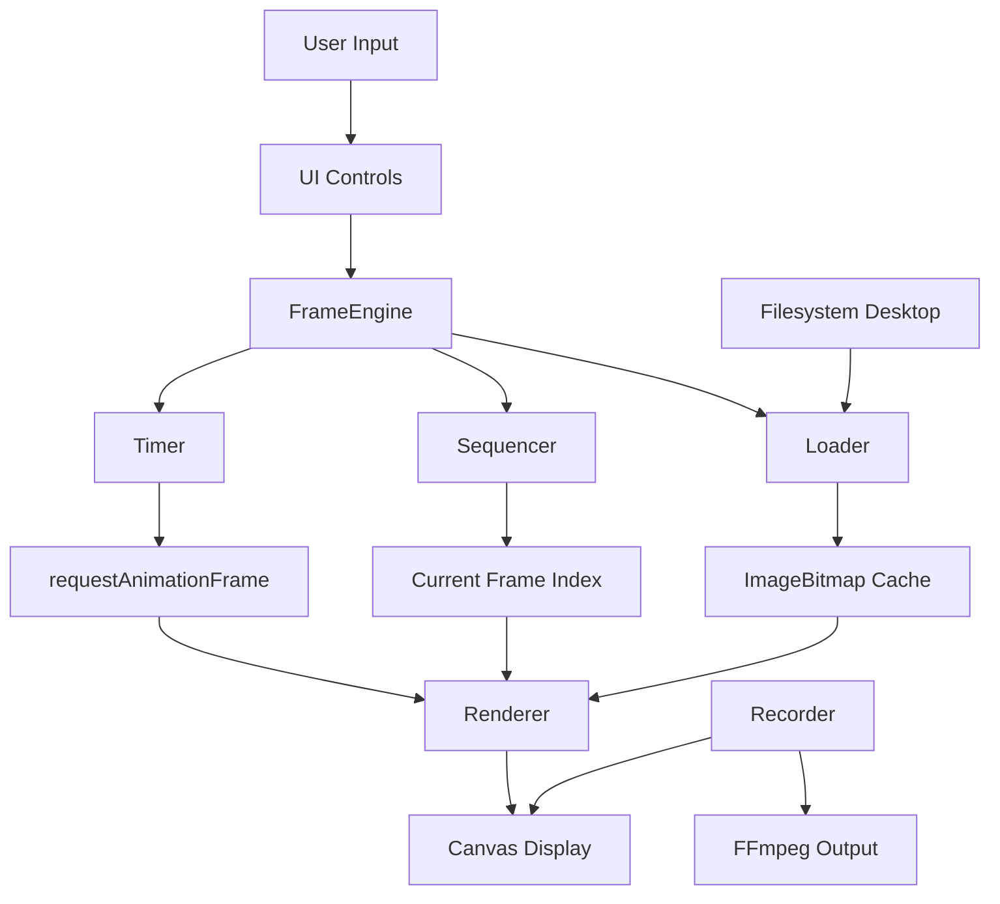

Perfecto, voy a hacer la investigación técnica primero y luego te presento el plan completo para tu aprobación. Después de eso crearemos el folder y pasamos a ejecución.

Déjame investigar:Perfecto, tengo suficiente contexto técnico. Ahora voy a crear el plan completo de implementación.

---

# **Implementation Plan - Stereo**

## **Problem Statement:**
Crear un reproductor visual de alto rendimiento que alterne entre frames de imágenes con control preciso de timing, orientado a estereoscopía, animación sprite, y efectos visuales experimentales. Debe funcionar tanto como aplicación desktop (con grabación) como componente web reutilizable.

---

## **Requirements:**

### **Core Functionality:**
- Motor de reproducción que lee N imágenes de una carpeta y cicla entre ellas
- Control dual: FPS global (24/30/60/120) + Hold frames (cuántos frames mantiene cada imagen)
- Navegación entre carpetas (proyectos) con controles minimal
- Dos modos: **EXPLORER** (navegación con thumbnails) y **PLAYER** (reproducción)
- UI compacta y elástica: controles laterales/bottom, ventana redimensionable
- Comportamiento **fill** para imágenes (no fit/contain por defecto)
- Configuración flexible: orden de imágenes, ratios de ventana, presets

### **Desktop Features:**
- Aplicación Electron standalone
- Grabación de output a video (FFmpeg)
- Acceso directo a filesystem local

### **Web Features:**
- Core exportable como Web Component o ES module
- Reutilizable en proyectos web (hero effects, galerías)
- Sin dependencias del filesystem

### **Performance:**
- Optimización para 60+ FPS
- Buffering inteligente (preload N+1, N+2)
- Canvas rendering con ImageBitmap para máxima velocidad
- RequestAnimationFrame loop optimizado

### **UI/UX:**
- **Explorer mode:** thumbnails animados (2fps preview), navegación con flechas + UP + ENTER
- **Player mode:** reproducción full canvas, ENTER se convierte en PLAY/PAUSE
- Settings panel: Order (alfabético/fecha/tamaño), ratios presets, configuración

---

## **Background:**

### **Technical Research:**

**Canvas Optimization (MDN):**
- Usar `ImageBitmap` con `createImageBitmap()` para preload optimizado
- `alpha: false` en context para rendering más rápido
- Evitar coordenadas flotantes (usar `Math.floor()`)
- `requestAnimationFrame` en lugar de `setInterval`
- Offscreen canvas para pre-rendering de thumbnails
- CSS transforms para scaling (usa GPU)

**Electron + Webpack:**
- Arquitectura main process (Node.js) + renderer process (web)
- Webpack para bundling de core + renderer
- IPC para comunicación filesystem ↔ UI

**Tailwind:**
- Utility-first CSS para UI rápida y personalizable
- Configuración con PostCSS en Webpack

**Jest:**
- Testing de core logic (timing, sequencing, loading)
- Mocks para Canvas API

---

## **Proposed Solution:**

### **Architecture:**

```
Stereo/
├── core/                    # Core TypeScript (agnóstico)
│   ├── FrameEngine.ts      # Motor principal
│   ├── Loader.ts           # Carga y buffering de imágenes
│   ├── Sequencer.ts        # Gestión de índices y loop
│   ├── Timer.ts            # FPS + hold frames logic
│   └── Renderer.ts         # Canvas rendering
│
├── desktop/                 # Electron app
│   ├── main/               # Main process
│   │   ├── main.ts         # Entry point
│   │   ├── filesystem.ts   # File operations
│   │   └── recorder.ts     # FFmpeg video recording
│   └── renderer/           # Renderer process
│       ├── index.html
│       ├── app.tsx         # UI React/Preact
│       └── styles/         # Tailwind
│
├── web/                     # Web Component
│   ├── StereoPlayer.ts     # Web Component wrapper
│   └── demo.html           # Demo page
│
├── test/                    # Jest tests
│   ├── Timer.test.ts
│   ├── Sequencer.test.ts
│   └── Loader.test.ts
│
└── docs/                    # Documentation
```

### **Data Flow:**



### **Tech Stack:**

- **Language:** TypeScript
- **Desktop:** Electron 28+
- **Build:** Webpack 5 + ts-loader
- **CSS:** Tailwind CSS 3
- **Testing:** Jest + ts-jest
- **Rendering:** Canvas API + ImageBitmap
- **Recording:** FFmpeg (fluent-ffmpeg wrapper)
- **UI Framework:** React/Preact (ligero para Electron)

---

## **Task Breakdown:**

### **Phase 1: Project Setup & Core Engine**

**Task 1: Initialize project structure and tooling**
- Crear estructura de carpetas (core/, desktop/, web/, test/, docs/)
- Configurar TypeScript con strict mode
- Setup Webpack con soporte TS + Tailwind
- Configurar Jest con ts-jest
- Crear package.json con scripts: `dev`, `build`, `test`
- **Demo:** `npm install && npm test` pasa sin errores

**Task 2: Implement Timer module (FPS + Hold)**
- Crear `Timer.ts` con lógica de FPS global y hold frames
- Calcular intervalo efectivo: `holdFrames / targetFPS`
- Exponer métodos: `start()`, `stop()`, `setFPS()`, `setHold()`, `tick(callback)`
- TDD: escribir tests primero (Jest)
- **Demo:** Timer ejecuta callbacks a intervalos correctos en tests

**Task 3: Implement Sequencer module**
- Crear `Sequencer.ts` para gestión de índices
- Loop circular: `next()`, `prev()`, `jumpTo(index)`
- Soporte para N items (no hardcodear 2 imágenes)
- TDD: tests de navegación y edge cases (lista vacía, 1 item)
- **Demo:** Sequencer navega correctamente entre 10 items mock

**Task 4: Implement Loader module with ImageBitmap**
- Crear `Loader.ts` para carga de imágenes
- Usar `createImageBitmap()` para optimización
- Buffering inteligente: preload current + N+1 + N+2
- Gestión de memoria: liberar bitmaps viejos
- Soporte para orden configurable (alfabético, fecha, tamaño)
- TDD: mock de filesystem, tests de preload
- **Demo:** Loader carga 5 imágenes mock y libera memoria correctamente

**Task 5: Implement Renderer module**
- Crear `Renderer.ts` con Canvas API
- Rendering con `drawImage()` usando ImageBitmap
- Comportamiento fill (scale + crop para llenar canvas)
- Optimizaciones: `alpha: false`, coordenadas enteras
- Responsive: resize canvas con devicePixelRatio
- TDD: tests con canvas mock
- **Demo:** Renderer dibuja ImageBitmap en canvas con fill correcto

**Task 6: Integrate FrameEngine (orquestador)**
- Crear `FrameEngine.ts` que coordina Timer + Sequencer + Loader + Renderer
- Loop principal con `requestAnimationFrame`
- Métodos: `play()`, `pause()`, `next()`, `prev()`, `loadFolder(path)`
- Event emitters para estado (playing, paused, frameChanged)
- TDD: tests de integración con mocks
- **Demo:** FrameEngine reproduce 3 imágenes mock a 2 FPS hold=10

---

### **Phase 2: Desktop App (Electron)**

**Task 7: Setup Electron boilerplate**
- Configurar main process (`desktop/main/main.ts`)
- Configurar renderer process con Webpack target
- IPC setup para comunicación main ↔ renderer
- Window creation con opciones: resizable, frameless opcional
- Hot reload con webpack-dev-server
- **Demo:** Ventana Electron abre con "Hello World"

**Task 8: Implement filesystem module (main process)**
- Crear `filesystem.ts` con APIs para:
  - Listar carpetas de un directorio
  - Leer archivos de imagen de una carpeta
  - Ordenar por nombre/fecha/tamaño
  - Watch folder changes (opcional)
- Exponer via IPC a renderer
- **Demo:** Main process lee carpeta de test con 5 imágenes y devuelve metadata

**Task 9: Build Explorer UI (Tailwind + React)**
- Crear layout minimal: grid de thumbnails + controles bottom
- Componentes: `<FolderCard>`, `<NavControls>` (◄ UP ▶ ENTER)
- Thumbnails con preview a 2fps (offscreen canvas)
- Estado: lista de carpetas, carpeta seleccionada
- Tailwind: diseño compacto, responsive
- **Demo:** UI muestra 3 carpetas mock con thumbnails estáticos

**Task 10: Wire Explorer to filesystem**
- Conectar UI con IPC filesystem module
- Botón UP: sube un nivel en directorio
- Flechas ◄▶: navega entre carpetas hermanas
- ENTER: carga carpeta en FrameEngine, cambia a Player mode
- Render real de thumbnails con FrameEngine mini-instance
- **Demo:** Navegar entre carpetas reales del filesystem y ver thumbnails

**Task 11: Build Player UI**
- Crear layout: canvas full + controles laterales/bottom
- Componentes: `<CanvasView>`, `<PlayerControls>` (◄ PLAY/PAUSE ▶ UP)
- Settings panel: sliders FPS/Hold, dropdown Order, botones Ratio
- Estado: playing/paused, fps, hold, currentFolder
- Tailwind: controles minimal, overlay sobre canvas
- **Demo:** UI estática con todos los controles visibles

**Task 12: Wire Player to FrameEngine**
- Integrar FrameEngine con canvas del componente `<CanvasView>`
- PLAY/PAUSE controla `engine.play()` / `engine.pause()`
- Flechas ◄▶ llaman `engine.prev()` / `engine.next()`
- Sliders ajustan FPS y Hold en tiempo real
- UP regresa a Explorer mode
- **Demo:** Reproducir carpeta real con 3+ imágenes, ajustar FPS/Hold en vivo

**Task 13: Implement settings panel**
- Dropdown para orden: alfabético, fecha modificación, fecha creación, tamaño
- Botones ratio presets: 16:9, 4:3, 1:1, 21:9, Free
- Aplicar cambios reactivamente (recargar folder con nuevo orden)
- Persistencia local (localStorage o config file)
- **Demo:** Cambiar orden reordena imágenes; cambiar ratio ajusta ventana

---

### **Phase 3: Recording & SVG Test**

**Task 14: Implement FFmpeg recorder (main process)**
- Crear `recorder.ts` con fluent-ffmpeg
- Capturar canvas con `MediaRecorder` API o Canvas stream
- Exportar a MP4/WebM configurable
- IPC para start/stop recording desde UI
- Progress tracking y notificación al completar
- **Demo:** Grabar 5 segundos de reproducción a archivo MP4

**Task 15: Add recorder UI controls**
- Botón REC en Player mode
- Indicador visual de grabación activa
- Dialog para configurar: formato, FPS output, duración
- Notificación al completar con path del archivo
- **Demo:** Grabar reproducción y abrir archivo resultante

**Task 16: Create SVG test images (vanishing point)**
- Generar par de SVGs con punto de fuga desplazado
- Efecto parallax/profundidad al alternar
- Documentar en `docs/test-assets/` con explicación
- Crear carpeta de test en proyecto con estos SVGs
- **Demo:** Abrir carpeta test y ver efecto de profundidad convincente a 10 Hz

---

### **Phase 4: Web Component Export**

**Task 17: Create Web Component wrapper**
- Crear `web/StereoPlayer.ts` como Custom Element
- Exponer FrameEngine via Shadow DOM
- Attributes: `src` (folder URL), `fps`, `hold`, `order`
- Methods: `play()`, `pause()`, `next()`, `prev()`
- Events: `framechange`, `play`, `pause`
- **Demo:** `<stereo-player src="./images">` funciona en HTML standalone

**Task 18: Build web bundle and demo page**
- Webpack config para bundle ES module
- Crear `web/demo.html` con ejemplos de uso
- CDN-ready build (UMD + ES modules)
- Documentación de API en README
- **Demo:** Demo page carga desde CDN y reproduce imágenes

**Task 19: Test Web Component integration**
- Crear ejemplo con React
- Crear ejemplo con Vue
- Crear ejemplo vanilla JS
- Verificar compatibilidad cross-browser
- **Demo:** Mismo componente funciona en 3 frameworks diferentes

---

### **Phase 5: Documentation & Polish**

**Task 20: Write comprehensive documentation**
- README.md: quick start, installation, screenshots
- ROADMAP.md: completed features, future ideas (gaussian splatting, interpolation)
- docs/PRD.md: este documento completo
- docs/ARCHITECTURE.md: diagramas, módulos, decisiones técnicas
- CONTRIBUTING.md: setup, coding standards, testing
- Code comments y JSDoc en módulos core
- **Demo:** Un usuario nuevo puede clonar, instalar, y correr el proyecto siguiendo README

**Task 21: Performance testing and optimization**
- Benchmarking: medir FPS real vs target en diferentes escenarios
- Memory profiling: verificar que buffering no causa leaks
- Optimizar: lazy loading, mejor caching, debounce de resize
- Testing con imágenes grandes (4K+)
- Testing con folders grandes (100+ imágenes)
- **Demo:** Reproducir 50 imágenes 4K a 60fps sin drops

**Task 22: Final polish and packaging**
- Electron app icons y metadata
- Build de producción optimizado (minify, tree-shaking)
- Installers: Windows (NSIS), macOS (DMG), Linux (AppImage)
- Web bundle: minificado, source maps
- Version tagging (v0.1.0)
- **Demo:** Instalar app desde installer, funciona standalone sin Node.js

---

## **Future Enhancements (Post-MVP):**

- Interpolación entre frames (motion blur, tweening)
- Efectos avanzados (gaussian splatting, depth maps)
- Soporte para video files (no solo imágenes)
- Playlist/secuencias complejas
- Plugins system para efectos custom
- Collaborative features (shared galleries)
- Mobile apps (React Native con mismo core)

---

¿Este plan te parece completo? ¿Algo que quieras ajustar antes de pasar a ejecución?
